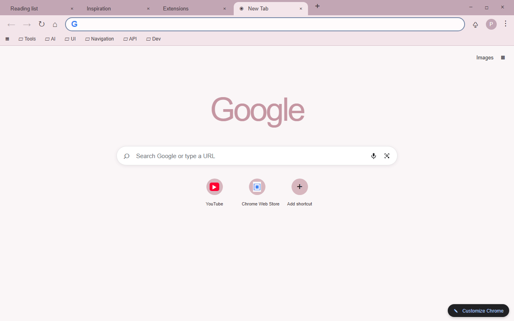
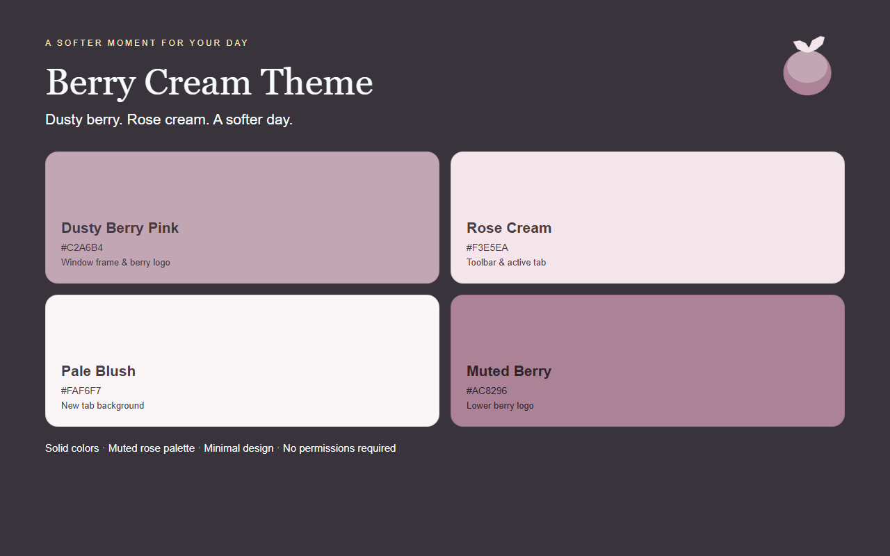
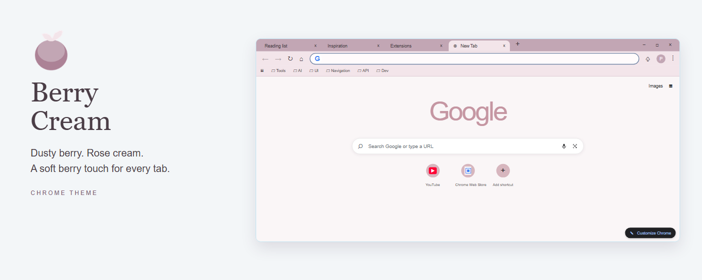
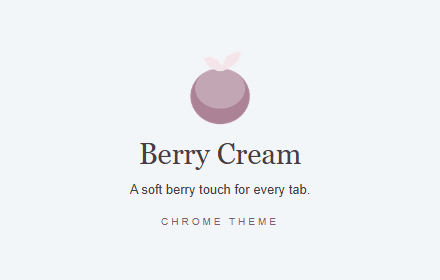

<p align="center">
  
</p>

<h1 align="center">Berry Cream Theme</h1>

<p align="center">
  <em>莓紫奶霜</em><br>
  A refined Chrome theme in dusty berry, rose cream, and soft blush.<br>
  Solid colors only — no wallpaper, no gradient, no texture.
</p>

<p align="center">
  
  
  
</p>

---

## Overview

Berry Cream Theme wraps Chrome in a muted berry palette. A dusty berry frame holds a rose-cream tab strip and toolbar, and the new tab page opens on pale blush so the interface keeps room to breathe.

Muted plum text (`#4A3D46`) carries tab titles, bookmarks, toolbar icons and new tab text, so the soft surfaces stay readable at 12–13px. Berry ink (`#805C73`) is the only accent: it colors new tab links and the header row. The address bar is the lightest surface in the window, so the field you type in reads as a distinct element.

The theme recolors only what Chrome themes are allowed to touch. It does not restyle websites, does not replace the new tab page, and ships with no scripts and no permission requests.

## Features

- **Solid colors only** — no wallpaper, no gradient, no texture, nothing to download.
- **Three soft layers** — pale blush `#FAF6F7` new tab page, rose cream `#F3E5EA` toolbar and active tab, dusty berry `#C2A6B4` frame.
- **Readable by default** — muted plum `#4A3D46` text and icons on every light surface.
- **One frame tone** — active and inactive windows share the same berry, so switching windows never reveals a second color scheme.
- **Color-matched Google wordmark** — tinted by Chrome itself through `ntp_logo_alternate`; the browser generates the exact tone, which lands on a soft dusty rose.
- **Theme only** — `manifest.json` declares a `theme` block and nothing else: no scripts, no content styling, no access to the pages you visit.

## Color palette

| Role | Hex | RGB | Used for |
|------|-----|-----|----------|
| Dusty Berry Pink | `#C2A6B4` | 194, 166, 180 | Window frame (active and inactive), window buttons, button background |
| Rose Cream | `#F3E5EA` | 243, 229, 234 | Toolbar, active tab, bookmarks bar |
| Pale Blush | `#FAF6F7` | 250, 246, 247 | New tab page background |
| Rose White | `#FFFBFC` | 255, 251, 252 | Address bar field |
| Muted Plum | `#4A3D46` | 74, 61, 70 | Tab titles, bookmark and toolbar text, toolbar icons, omnibox text, new tab text |
| Dark Plum | `#463942` | 70, 57, 66 | Inactive tab titles |
| Berry Ink | `#805C73` | 128, 92, 115 | New tab links and header |
| Muted Berry | `#AC8296` | 172, 130, 150 | Logo — lower berry |

The upper berry of the logo reuses the frame tone, and the leaf cap uses rose cream, so the mark and the interface share one palette. Window glyphs, hover states and separators are drawn by Chrome and your operating system.

## Design

- Dusty berry as the frame: a warm tone with the saturation dialed well back, so it frames the window without competing with page content.
- Large surfaces stay light for long sessions; nothing in the interface is a saturated fill.
- The three light surfaces step apart on purpose — pale blush for the page, rose cream for the chrome around it, rose white for the field you type in.
- Pure flat color throughout: no images, no pattern, no decorative gradient.

## Preview

Store screenshots and promo tiles are illustrative HTML/CSS layouts rendered by headless Chromium from the exact `manifest.json` colors, calibrated against a real installed Chrome session. They are not native Chrome captures, so fine details (window glyphs, hover states, the Google wordmark tone) follow your own browser and operating system after install.

### Store screenshots · 1280×800

**Browser interface** — the themed window with a bookmarks bar and the new tab page.



**Palette & highlights** — the palette tones and what each one controls.



### Promo tiles

**Marquee tile — 1400×560**



**Small tile — 440×280**



## Install

### Load unpacked

1. Open `chrome://extensions` in Chrome.
2. Enable **Developer mode** (top-right toggle).
3. Click **Load unpacked** and select this folder.
4. The theme applies immediately; reset it any time under Settings, then Appearance, then Themes.

### From the Chrome Web Store

> Coming soon — the install link will be added here once the listing is live.

## Logo

A flat transparent mark: one rounded berry in two berry tones with a cream leaf cap. No outline, no gradient, no shadow. Only `logo/logo128.png` (128×128) is referenced by the manifest, and the same file is used for the repository and the store listing.

## Project structure

```
berry-cream-theme/
├─ manifest.json                 # Theme definition (Manifest V3, no scripts)
├─ logo/logo128.png              # The single 128×128 theme icon
├─ README.md
├─ LICENSE                       # Non-Commercial License (bilingual)
├─ scripts/
│  ├─ generate-logo.py           # Draws the 128×128 mark
│  ├─ generate-store-assets.py   # Renders screenshots and promo tiles
│  ├─ package.ps1                # Builds the release ZIP
│  └─ requirements.txt
└─ store-assets/
   ├─ screenshots/en/            # 2 × 1280×800 store screenshots
   ├─ promo/                     # 440×280 + 1400×560 promo tiles
   ├─ references/                # HTML sources and PNG renders of every asset
   ├─ ASSET-NOTES.md             # Asset decisions and calibration notes
   └─ store-description.txt      # Store listing description (English)
```

## Regenerate assets

```bash
pip install -r scripts/requirements.txt
playwright install chromium

python scripts/generate-logo.py
python scripts/generate-store-assets.py
```

`generate-logo.py` only exports `logo/logo128.png`. One composer renders all four store assets — both screenshots, both promo tiles, and the HTML sources in `store-assets/references/` — so a style change is made in the script and re-rendered, never patched onto a PNG.

## Package

```powershell
powershell -ExecutionPolicy Bypass -File scripts/package.ps1
```

The script writes one archive into the default folder `D:\迅雷下载\vibe coding`: `berry-cream-theme-1.0.0.zip`, with `manifest.json` at the archive root. The same file serves both purposes — **Load unpacked** locally and the Chrome Web Store upload form; screenshots and promo tiles are uploaded separately in the listing form.

The archive is validated before the script exits: the manifest must sit at the archive root, every icon referenced by the manifest must be present, and no `.git`, `.codebuddy`, `__pycache__`, `.pak`, `.crx` or nested `.zip` entries may slip in. Pass `-Force` to overwrite an existing archive of the same version, or `-OutputDirectory` to write somewhere else.

## License

**Non-Commercial License** — see [`LICENSE`](LICENSE).

- Personal use, modification, and redistribution are permitted.
- Commercial use of any kind (bundling, resale, paid services) is not.
- For commercial licensing, contact the author.
